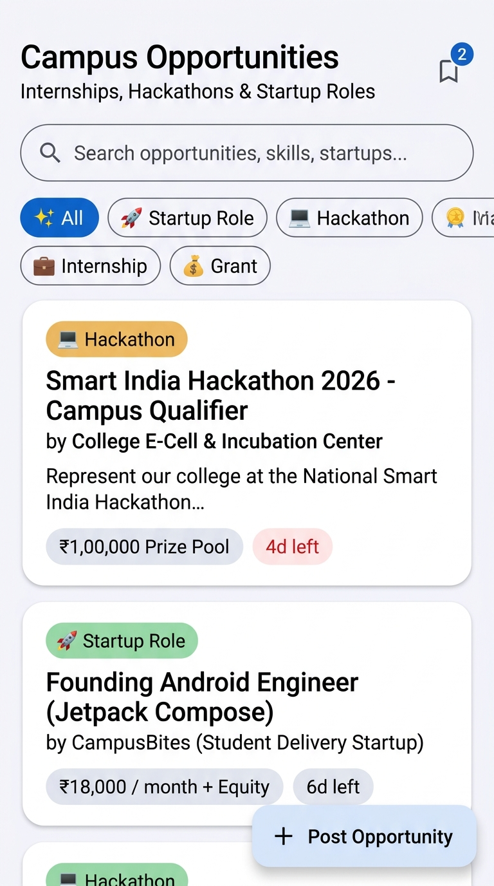
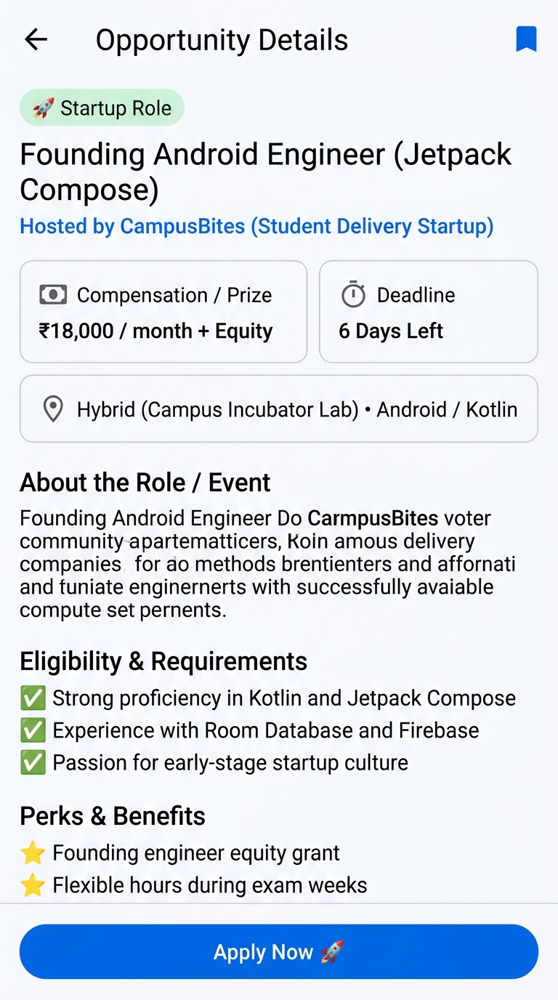
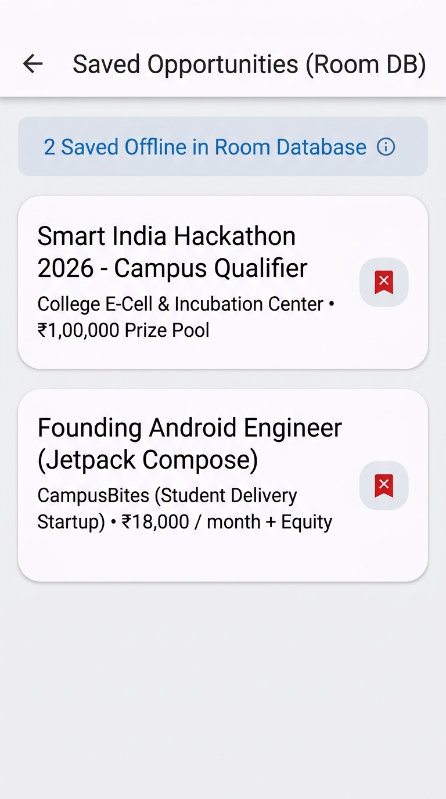
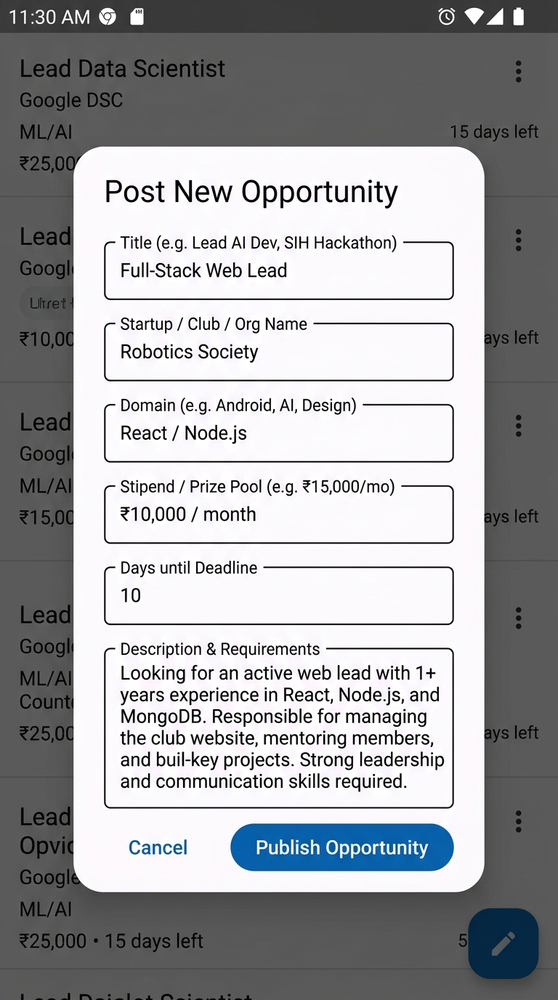

# 🚀 VentureUp — Campus Startup Finder
### *Branch: `feature-opportunities`*

[](https://developer.android.com)
[](https://kotlinlang.org)
[](https://developer.android.com/jetpack/compose)
[-F58220?style=for-the-badge&logo=sqlite&logoColor=white)](https://developer.android.com/training/data-storage/room)
[-brightgreen?style=for-the-badge)](https://developer.android.com)
[](https://developer.android.com)

**VentureUp** is a modern Android mobile platform designed to bridge the gap between campus entrepreneurs, student developers, and university startup ecosystems. It enables students to discover high-impact startup roles, hackathons, non-dilutive seed grants, competitions, and internships happening across universities and incubation cells.

This branch (`feature-opportunities`) delivers the complete end-to-end **Opportunities Module**, featuring reactive search and filtering, rich detail breakdowns, an offline-first bookmarking engine powered by **Room Database**, and an interactive listing submission dialog.

---

## 📱 Visual Showcase & Screenshots

<table align="center">
  <tr>
    <td align="center" width="25%"><b>1. Opportunities Feed</b></td>
    <td align="center" width="25%"><b>2. Opportunity Details</b></td>
    <td align="center" width="25%"><b>3. Saved (Room DB)</b></td>
    <td align="center" width="25%"><b>4. Post Opportunity</b></td>
  </tr>
  <tr>
    <td></td>
    <td></td>
    <td></td>
    <td></td>
  </tr>
</table>

---

## ✨ Features Introduced in this Branch

### 1. 🔍 Dynamic Opportunities Discovery Feed
- **Live Search**: Instant keyword matching across role titles, startup/organization names, and technical domains (e.g., *Kotlin*, *AI*, *Figma*, *Smart Governance*).
- **Category Filter Chips**: Fast horizontal filtering across multiple opportunity categories:
  - ✨ **All Openings**
  - 🚀 **Startup Roles** (Founding engineers, growth leads, UI/UX designers)
  - 💻 **Hackathons** (Smart India Hackathon, campus hackathons)
  - 💼 **Internships** (Paid student internships)
  - 💰 **Grants & Funding** (Equity-free college prototype grants)
  - 🏆 **Competitions** (Pitch events, campus Shark Tank)
- **Status Pills & Countdown**: Displays real-time urgency with remaining deadline days (highlighted in rose red when $\le 5\text{ days}$) and stipend/prize highlights.
- **Bookmark Counter Badge**: Live Material 3 badged icon showing the number of opportunities saved offline.

### 2. 📄 Comprehensive Opportunity Detail View
- **Role & Event Header**: Organization attribution, category badge, and title.
- **Key Metrics Grid**: High-level snapshot of compensation/prize pool, deadline countdown, and format/location (e.g., *Hybrid*, *Remote*, *Campus Incubation Cell*).
- **Detailed Scope**: In-depth description of the project, role, or challenge.
- **Eligibility & Requirements**: Verified checklist of prerequisites with visual check indicators.
- **Perks & Benefits**: Highlighting non-monetary value like founder mentorship, credits, travel sponsorship, and equity.
- **One-Tap Apply**: Responsive application action with instant user confirmation snackbar.

### 3. 💾 Offline-First Bookmarking (Room Database)
- **Local SQLite Persistence**: Uses Android's native **Room Database 2.8.4** compiled with **KSP**.
- **Cross-Screen Synchronization**: Bookmarks toggled in the feed or details view immediately reflect in the local database and update reactive StateFlows across the app.
- **Dedicated Offline Screen**: Access saved items without internet connectivity, complete with single-tap removal and deep navigation into details.

### 4. ✍️ Community Opportunity Posting Dialog
- **Direct Submissions**: Students, club leads, and incubation managers can publish new openings directly into the app.
- **Reactive State Update**: Automatically prefixes new listings to the active feed flow without requiring manual refreshes or page reloads.

---

## 🏗️ Architecture & Technical Stack

The module strictly follows **Modern Android Architecture (Clean Architecture / MVI-MVVM)** with unidirectional data flow:

```
┌────────────────────────────────────────────────────────┐
│                   UI Layer (Compose)                   │
│   OpportunitiesFeedScreen  •  OpportunityDetailScreen  │
│   SavedOpportunitiesScreen •  PostOpportunityDialog    │
└───────────────────────────▲────────────────────────────┘
                            │ StateFlow / Events
┌───────────────────────────┴────────────────────────────┐
│              ViewModel Layer (Coroutines)              │
│                 OpportunitiesViewModel                 │
│      - Combines UI filters, queries, & Room cache      │
└───────────────────────────▲────────────────────────────┘
                            │ Reactive Flow
┌───────────────────────────┴────────────────────────────┐
│                    Repository Layer                    │
│                 OpportunityRepository                  │
└─────────────▲────────────────────────────▲─────────────┘
              │ Flow                       │ Suspend / Flow
┌─────────────┴─────────────┐  ┌───────────┴─────────────┐
│    In-Memory / Remote     │  │   Room Local Database   │
│     Opportunities Flow    │  │    OpportunityDao       │
└───────────────────────────┘  └─────────────────────────┘
```

### Libraries & Dependencies

| Component | Library / Version | Purpose |
| :--- | :--- | :--- |
| **Language** | Kotlin `2.2.10` | First-class coroutines and functional programming |
| **UI Toolkit** | Jetpack Compose BOM `2024.09.00` | Declarative, reactive UI development |
| **Design System**| Material 3 (`material3:1.x`) | Design tokens, color schemes, surface elevation |
| **Navigation** | Navigation Compose `2.8.5` | Type-safe in-app screen routing |
| **Local Database**| Room `2.8.4` + KSP `2.3.4` | SQLite object mapping and persistence |
| **Asynchronous** | Kotlinx Coroutines & Flow | Asynchronous event streaming and state sharing |
| **Lifecycle** | Lifecycle Runtime Compose `2.10.0` | Lifecycle-aware StateFlow collection |
| **Build System** | Android Gradle Plugin `9.0.0` | Gradle Kotlin DSL with Version Catalogs |

---

## 📂 Project Directory Structure

```
CampusStartupFinder/
├── app/
│   ├── build.gradle.kts                     # App-level dependencies & Android configuration
│   ├── proguard-rules.pro                   # R8 / Proguard optimization rules
│   └── src/
│       └── main/
│           ├── AndroidManifest.xml          # App manifest & launcher activity declaration
│           ├── java/com/campus/startup/
│           │   ├── MainActivity.kt          # Single-Activity host with Jetpack Navigation
│           │   ├── core/
│           │   │   ├── database/
│           │   │   │   └── AppDatabase.kt   # Room Database definition & singleton builder
│           │   │   ├── navigation/
│           │   │   │   └── Screen.kt        # Sealed navigation routes (Feed, Detail, Saved)
│           │   │   └── theme/
│           │   │       ├── Color.kt         # VentureUp brand color palette & category tints
│           │   │       ├── Theme.kt         # Material3 Dynamic / Static Theme setup
│           │   │       └── Type.kt          # Material3 Typography tokens
│           │   └── features/opportunities/
│           │       ├── data/
│           │       │   ├── local/
│           │       │   │   ├── OpportunityDao.kt       # Room DAO with reactive Flow queries
│           │       │   │   └── OpportunityEntity.kt    # Room @Entity definition
│           │       │   ├── model/
│           │       │   │   ├── Opportunity.kt          # Domain data model
│           │       │   │   └── OpportunityType.kt      # Enum with emojis and display labels
│           │       │   └── repository/
│           │       │       └── OpportunityRepository.kt # Data repository coordinating DB & feed
│           │       └── presentation/
│           │           ├── OpportunitiesFeedScreen.kt  # Main feed with search & category filters
│           │           ├── OpportunityDetailScreen.kt  # Deep-dive screen with requirements & perks
│           │           ├── SavedOpportunitiesScreen.kt # Offline saved bookmarks screen
│           │           ├── PostOpportunityDialog.kt    # Dialog modal for submitting new openings
│           │           ├── OpportunitiesViewModel.kt   # MVI ViewModel & StateFlow management
│           │           ├── OpportunitiesUiState.kt     # Sealed interface for UI state
│           │           └── components/
│           │               ├── CategoryChipRow.kt      # Horizontal scrollable category chips
│           │               ├── OpportunityCard.kt      # Rich preview card with deadline & stipend
│           │               └── SearchBarComponent.kt   # Modern Material3 search textfield
│           └── res/
│               └── values/
│                   ├── strings.xml          # App name and resource strings
│                   └── themes.xml           # Base Android theme declaration
├── gradle/
│   ├── libs.versions.toml                   # Central Gradle Version Catalog
│   └── wrapper/                             # Gradle wrapper files
├── screenshots/                             # Mockup and UI screenshot assets
│   ├── 01_feed_screen.jpg
│   ├── 02_detail_screen.jpg
│   ├── 03_saved_screen.jpg
│   └── 04_post_dialog.jpg
├── build.gradle.kts                         # Root build configuration
├── settings.gradle.kts                      # Project and repository management
└── README.md                                # Project documentation
```

---

## 🛠️ Getting Started & Installation

### Prerequisites
- **Android Studio**: Android Studio Ladybug (2024.2.1+) or newer.
- **JDK**: Java Development Kit 11 or 17+.
- **Android SDK**: Compile SDK `36`, Minimum SDK `26` (Android 8.0 Oreo).

### Setup Steps

1. **Open the Project in Android Studio**:
   - Launch Android Studio.
   - Select **Open** and navigate to this directory (`VentureUp_Campus_Startup_Finder-feature-opportunities`).

2. **Sync Gradle**:
   - Allow Android Studio to automatically download dependencies defined in `gradle/libs.versions.toml`.
   - Ensure the Gradle JDK is configured to JDK 17 or 21 in **Settings > Build, Execution, Deployment > Build Tools > Gradle**.

3. **Run on Emulator or Physical Device**:
   - Connect an Android device (via USB with USB debugging enabled) or launch an Android Virtual Device (AVD).
   - Press **Shift + F10** or click the green **Run (▶)** button in Android Studio.

### Command-Line Build

You can also build the application directly via the Gradle Wrapper:

```bash
# On Windows (PowerShell / Command Prompt)
.\gradlew assembleDebug

# On macOS / Linux
./gradlew assembleDebug
```

The resulting debug APK will be generated at:
```
app/build/outputs/apk/debug/app-debug.apk
```

---

## 🎨 Color Palette & Design System

The application uses a purposeful, startup-centric color palette designed for legibility and visual hierarchy:

| Color Role | Hex Code | Visual Preview | Description |
| :--- | :--- | :--- | :--- |
| **Primary Blue** | `#2563EB` |  | Primary buttons, active state chips, and brand emphasis |
| **Startup Green** | `#059669` |  | Startup role tags, verified badge indicators |
| **Hackathon Amber** | `#D97706` |  | Hackathons and pitch competition badges |
| **Internship Indigo** | `#4F46E5` |  | Student internship tags |
| **Grant Rose** | `#E11D48` |  | Prototype grant funding and urgent countdown tags |
| **Background Light** | `#F8FAFC` |  | Clean slate surface background |

---

## 🗺️ Roadmap & Next Steps

- [x] Initial Opportunities Feed with Live Search & Category Filtering
- [x] Opportunity Detail Screen with Requirements, Perks, & One-Tap Apply
- [x] Room Database offline bookmarking engine
- [x] In-app Post Opportunity modal dialog
- [ ] Remote Backend Integration (Cloud Firestore / Supabase REST API)
- [ ] Push Notifications for approaching deadlines ($\le 24\text{ hours}$)
- [ ] PDF / Resume upload integration for 1-click student applications
- [ ] Startup Founder & Admin Dashboard for tracking applicants

---

## 📄 License

This project is developed as part of the **VentureUp Campus Startup Finder** initiative. All rights reserved.
